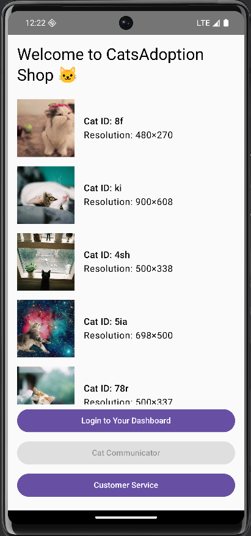
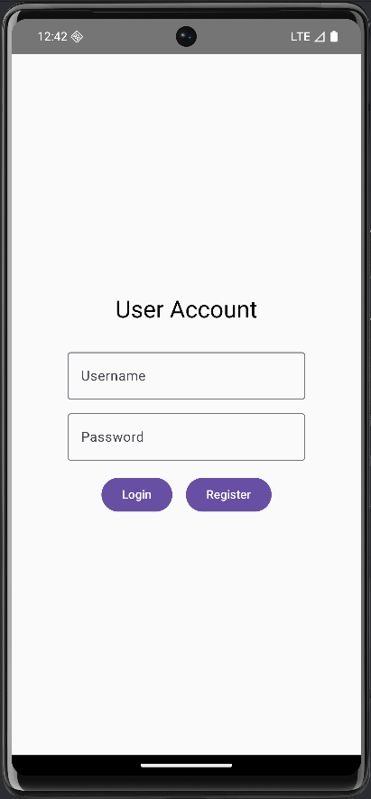

# Mobile Security project -  G30 - Documentation

## Groupmember
1. Moestafa Alhaj Abdo
2. Abdullah Shafaquet
3. Zeiniddin Fatayrji
4. Ameer Shahpoor

## Project summary
The "Cats Adoption Shop" is an Android application built using Kotlin. The app allows users to browse cat listings fetched from a public API, register for an account, and log in to a personal dashboard. The project intentionally implements both secure practices (e.g., SQL injection-safe Room database, SSL pinning) and security vulnerabilities (e.g., weak credential storage, bypassable root detection using Frida, IDOR) to showcase both secure functions and intentionally added vulnerabilities.

## Requirements
### ℹ️ Legend
- ✔️ = Implemented
- ❌ = Not implemented
- ⌛ = Work in progress

 
|Status|Description|Details|
|---|---|---|
| | **Application** || 
|✔️ | 2 UI screens
|✔️ | Secure API request
|✔️ | API request with IDOR
|✔️ | Connection to room database
|⌛ | Secure storage
| |  || 
|  | **Security** || 
|✔️ | Unsafe storage
|✔️ | Malware
|✔️ | Frida functionality
|✔️ | Detect root and block functionality

## Overview app
*Describe the implementation of the following topics.*

### Screenshots
*Give screenshots for every screen in the application. Give each screen an unique name.*

This is the screen you see on startup, the Cat Listing Screen, which shows a list of available cats for adoption. The bottom of the screen contains three primary buttons (visible in the screenshot) that lead to other parts of the app:

- **Login to Your Dashboard**: Navigates to the Login / Registration screen. After a successful login the app navigates to the User Dashboard.

- **Cat Communicator**: This button is guarded by a root-detection check and is disabled when the device is detected as rooted (the screenshot shows it disabled/greyed out). The intended flow requests microphone permission (see `PermissionCheckActivity`) and schedules the communicator/recording work; in `MainActivity` the communicator click handler is currently a placeholder.

- **Customer Service**: This button navigates to the User Profile screen for a hardcoded user (`route: "userProfile/1"`). The `UserProfileScreen` shows the title "Customer Service" when the loaded profile has role `owner`. Because the listings screen navigates to a fixed `userId` this demonstrates the IDOR-style route usage in the app (hardcoded/profile-by-id behavior).

Additionally, the app can show an **Admin Dashboard** button when `AppConfig.IS_ADMIN_ENABLED` is true; that button navigates to `admin_dashboard`.

### Secure API request
*Request to server x retrieving JSON in the following format displayed in screen x.*

### API request with IDOR
*Request to server x retrieving JSON in the following format displayed in screen x.*

### Room database
*Type of data stored in the database used in screen x and displayed in screen y.*

A local database was implemented using the Android Room Persistence Library to store user account information.
- **Type of data stored**: User credentials, the users `id`, `username` and `encryptedPassword`.
- **Implementation**: The `AppDatabase.kt` defines the database, which contains a `users` table based on the `User` entity. The `UserDao` interface provides safe access for creating and retrieving users.
- **Usage**: The database is used by the **Login Screen**. When a user clicks "Register", their details are written to the database. When they click "Login", their info gets queried to the database, so it can verify the users existence and password.

### Secure storage
Type of data stored used in screen x and displayed in screen y.

### Unsecure storage
Type of data stored used in screen x and displayed in screen y.

### Malware
Implementation of malware.

### Frida
Detail implementation of Frida

### Root
Implementation of the detecting root and block functionality.

## Link to Panopto video
https://

## Repositories
- Code
  - https://gitlab.ti.howest.be/ti/2025-2026/s3/mobilesecurity/students/group-30/catsadoptionshop/-/tree/dev?ref_type=heads
- APK
  - [Link to repository]